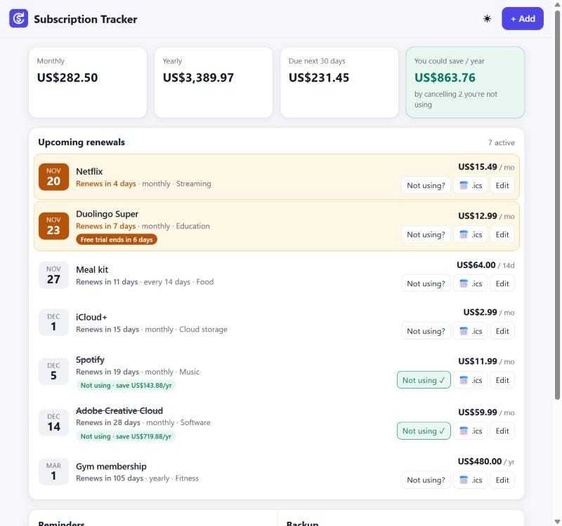

# Subscription Tracker

**Stop paying for things you forgot about.**

Free trials quietly turn into paid plans. Yearly renewals show up out of nowhere. Small monthly charges add up to a lot, and many of them are for services nobody uses any more. Subscription Tracker lists everything you pay for in one place, shows what it really costs per month and per year, and reminds you before anything renews so you have time to cancel.

**Live app: https://stravix86.github.io/subscription-tracker/**



## Features

- **Track every subscription:** name, price, currency, billing cycle (weekly, monthly, yearly, or every N days), next renewal date, category, and an optional free-trial end date.
- **See the real cost:** monthly and yearly totals, plus what's due in the next 30 days. Several currencies are totalled separately rather than converted.
- **Upcoming renewals first:** the list is sorted by date, and anything renewing (or any trial ending) within 7 days is highlighted.
- **"Not using" flag:** mark a subscription you don't use and see how much you'd save per year by cancelling it.
- **Reminders without a server:**
  - Download an `.ics` calendar file for one subscription or all of them. Each renewal is a repeating event with an alert at 9:00, 1–14 days before (you choose). Trial end dates get their own event.
  - Browser notifications while the app is open.
- **Dates keep themselves up to date:** once a renewal date passes, it rolls forward to the next one. Month-end dates stay correct, so a plan billed on the 31st renews on the 30th in 30-day months and the 31st again after that.
- **Private:** everything is stored in your browser (`localStorage`). There are no accounts, no analytics and no network requests.
- **Backup:** export to JSON and import it again on any device. Importing merges with what's already there.
- **Installable and offline:** a PWA with a service worker, so you can add it to your home screen and use it without a connection.
- **Light and dark themes** (follows your system, or pick one), and a layout that works down to phone width.
- **Tiny:** plain HTML, CSS and JavaScript. No framework, no dependencies, no build step.

## Run it locally

Clone the repo and serve the folder with any static file server:

```bash
git clone https://github.com/Stravix86/subscription-tracker.git
```

```bash
cd subscription-tracker
```

```bash
python -m http.server 8000
```

Then open http://localhost:8000. (`npx serve` works too.) Opening `index.html` directly from disk also works, but the service worker (offline mode) only runs over `http://localhost` or `https://`.

## How costs are calculated

| Cycle        | Yearly cost        |
|--------------|--------------------|
| Weekly       | price × 52         |
| Monthly      | price × 12         |
| Yearly       | price              |
| Every N days | price × 365 ÷ N    |

The monthly total is the yearly total divided by 12. "Due next 30 days" adds up every charge that falls within the next 30 days, so a weekly plan can count 4 or 5 times.

## Project layout

```
index.html            markup
style.css             styles, light and dark themes
app.js                all app logic
sw.js                 service worker (offline cache)
manifest.webmanifest  PWA manifest
icons/                app icons
```

When you change any file, bump `CACHE` in `sw.js` (for example `subtrack-v2`) so installed copies pick up the new version.

## License

MIT
